# Supported Costumes for the Costume Pool

`Samhain Xenotype: Hidden Hungers` contains patches for these mods to add them to the Costume Pool.

If the Samhain spawn unmasked, the Costume Pool will be used to find a costume for them.

You can control what appears in the Costume Pool via mod settings.

Any FullHead apparel can also be enabled as a costume in the mod settings even if it doesn't have a patch.

## Vanilla RimWorld Mods

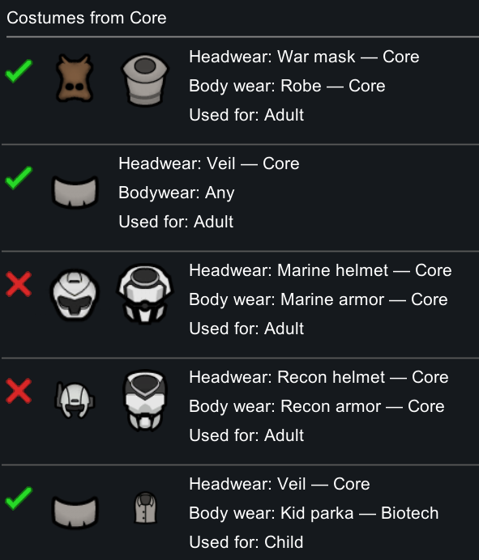

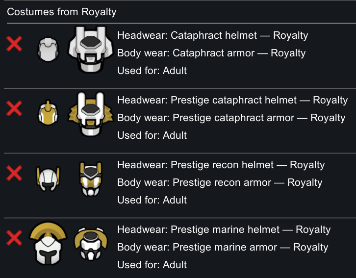

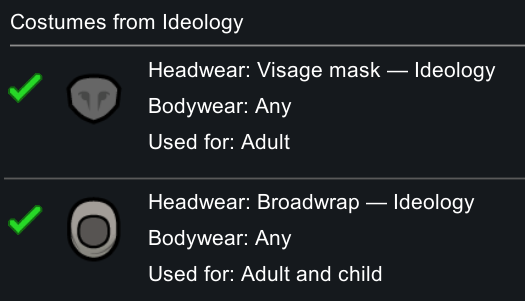

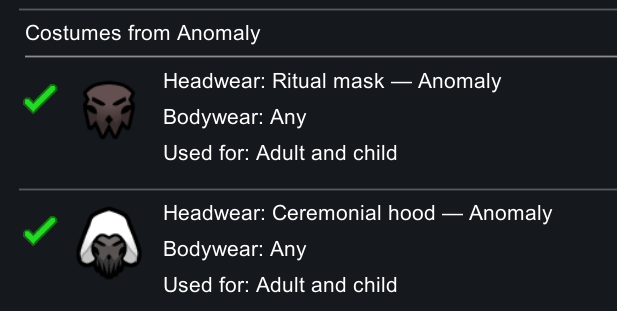

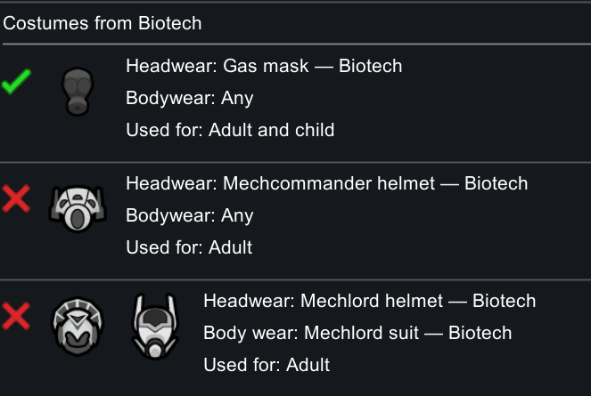

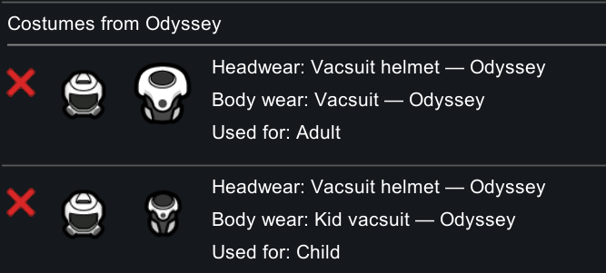

## Halloween-ish Mods

### [Sam's Trick or Treat Costume](https://steamcommunity.com/sharedfiles/filedetails/?id=3827335380)

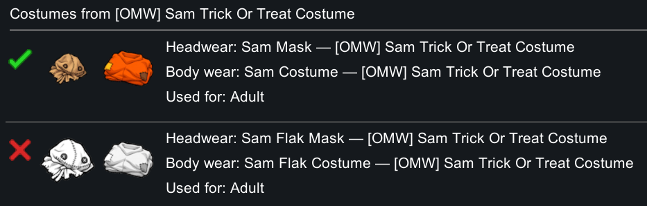

### [Arsenal Halloween](https://steamcommunity.com/sharedfiles/filedetails/?id=3828650645)

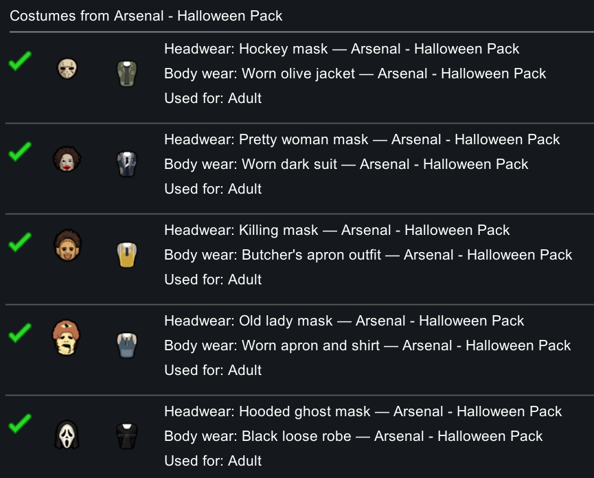

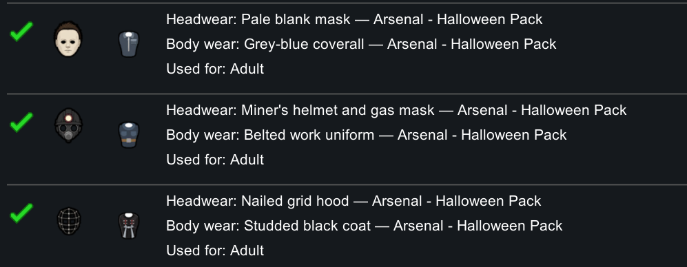

### [Biomes! Fossils](https://steamcommunity.com/sharedfiles/filedetails/?id=3100958580)

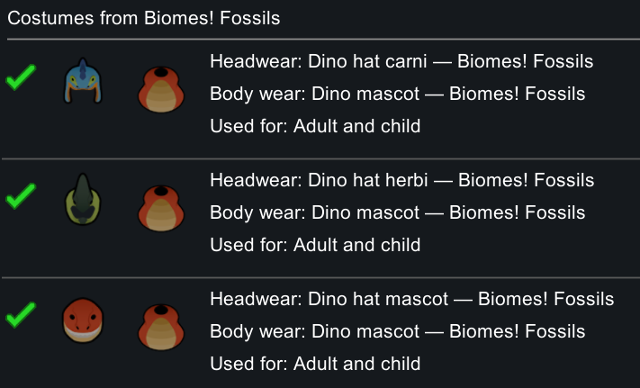

### [Clown Mod](https://steamcommunity.com/sharedfiles/filedetails/?id=3709355703)

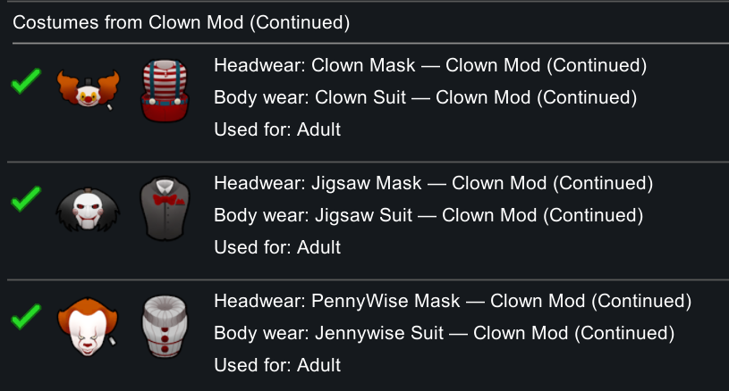

### [Deadpool's Outfit](https://steamcommunity.com/sharedfiles/filedetails/?id=2602834386)

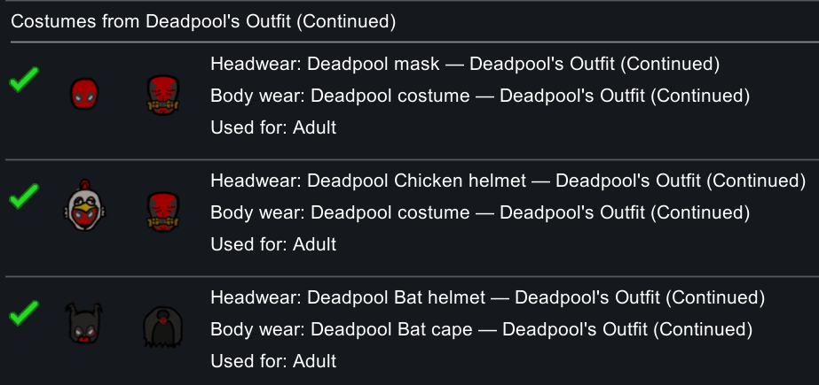

### [Turtleshroom's Pan-Halloweenie Integration 2](https://steamcommunity.com/sharedfiles/filedetails/?id=3593434506)

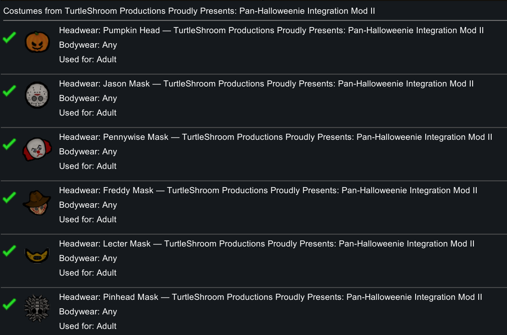
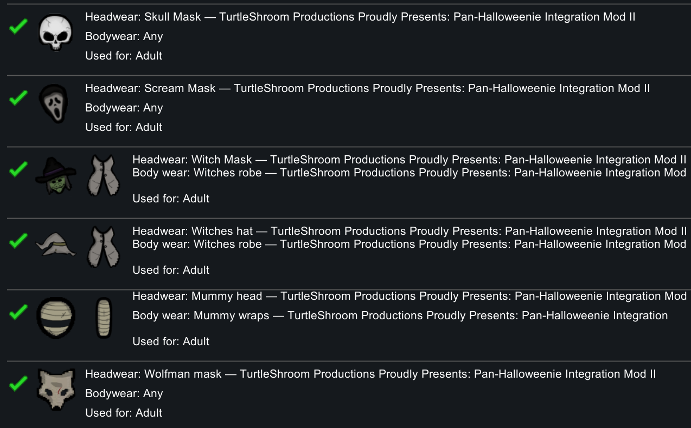
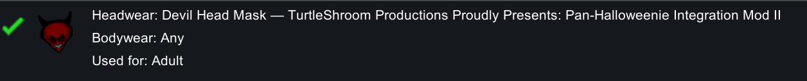

### [Plague Doctor's Outfit](https://steamcommunity.com/sharedfiles/filedetails/?id=3795739637)

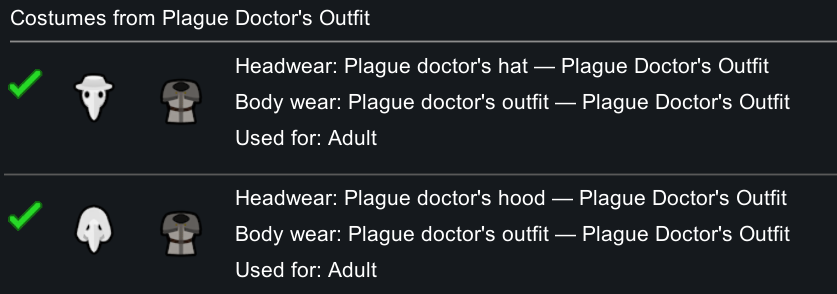

### [Lisa's Peasant Apparel](https://steamcommunity.com/sharedfiles/filedetails/?id=3793374806)

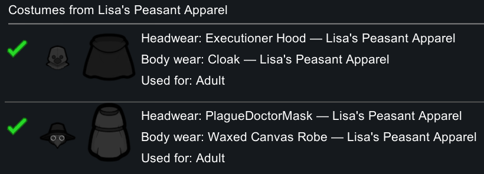

### [Lava's Spooky Halloween](https://steamcommunity.com/sharedfiles/filedetails/?id=3785375776)

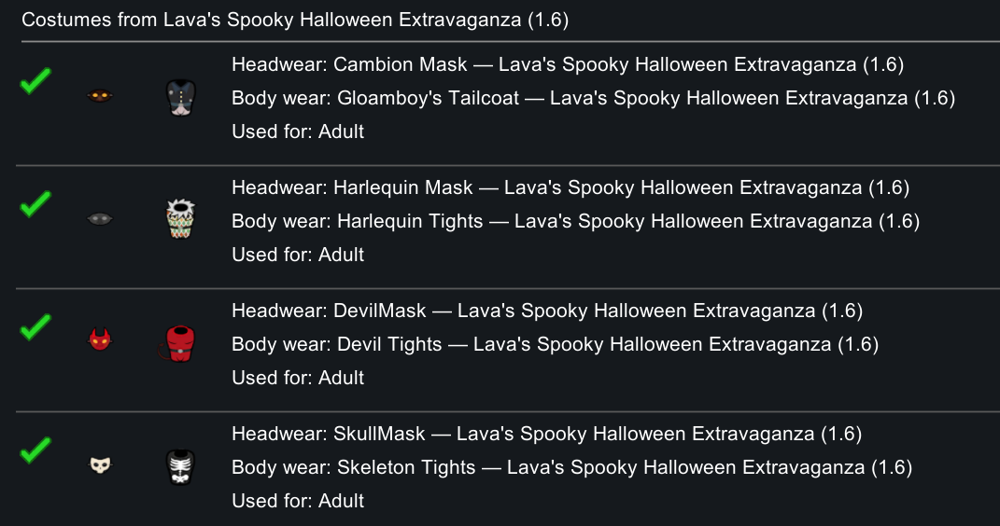

### [Ponpeco Kids' Clothes](https://steamcommunity.com/sharedfiles/filedetails/?id=3237739433)

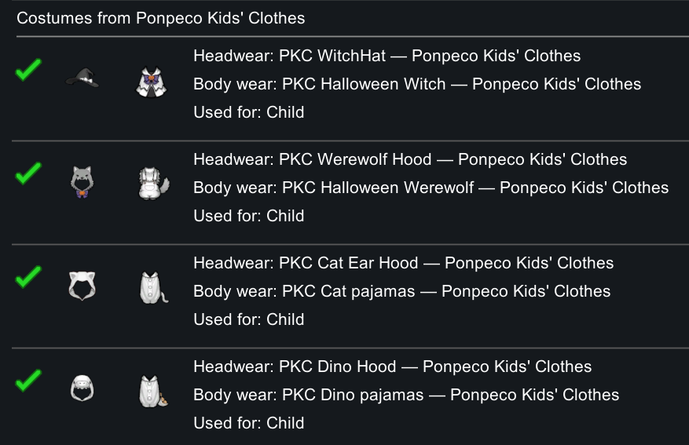

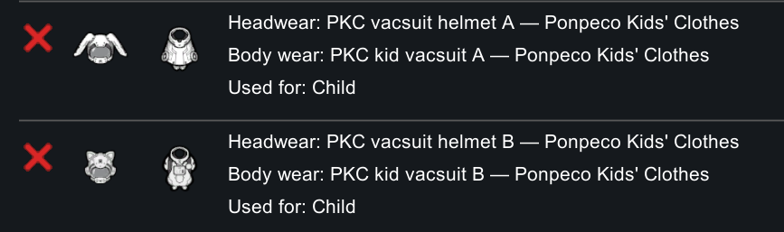

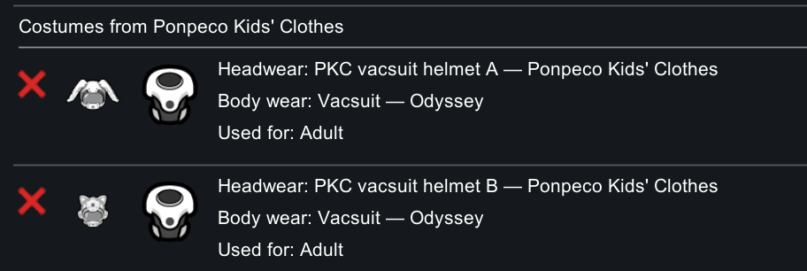

## Additional supported Workshop mods

### Hats, costumes, and apparel

- [Vanilla Ideology Expanded – Hats and Rags](https://steamcommunity.com/sharedfiles/filedetails/?id=2567387768)
- [Medieval Overhaul: Barbarians](https://steamcommunity.com/sharedfiles/filedetails/?id=3216459199)
- [Hooded Helms addon for Medieval Overhaul](https://steamcommunity.com/sharedfiles/filedetails/?id=2872166785)
- [More Medieval Helms and Armor](https://steamcommunity.com/sharedfiles/filedetails/?id=2776681900)

### Tasty Armory

- [Tasty Armory – Fire and Steel](https://steamcommunity.com/sharedfiles/filedetails/?id=3469863838)
- [Tasty Armory – Steppe Warriors](https://steamcommunity.com/sharedfiles/filedetails/?id=3472989392)
- [Tasty Armory – High Medieval](https://steamcommunity.com/sharedfiles/filedetails/?id=3480089301)
- [Tasty Armory – In Shining Armor](https://steamcommunity.com/sharedfiles/filedetails/?id=3482266407)
- [Tasty Armory – Sengoku](https://steamcommunity.com/sharedfiles/filedetails/?id=3494429497)

### Medieval Overhaul houses

- [Medieval Overhaul](https://steamcommunity.com/sharedfiles/filedetails/?id=3219596926)
- [Medieval Overhaul: House Roxmont](https://steamcommunity.com/sharedfiles/filedetails/?id=3526042587)
- [Medieval Overhaul: House Ignivar](https://steamcommunity.com/sharedfiles/filedetails/?id=3712538846)
- [Medieval Overhaul: House Zahir](https://steamcommunity.com/sharedfiles/filedetails/?id=3516409179)
