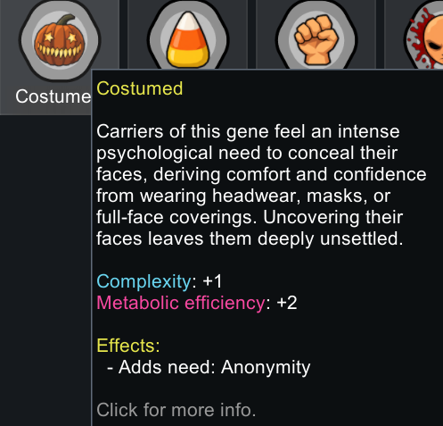
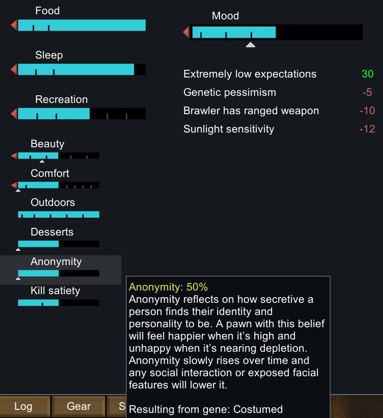
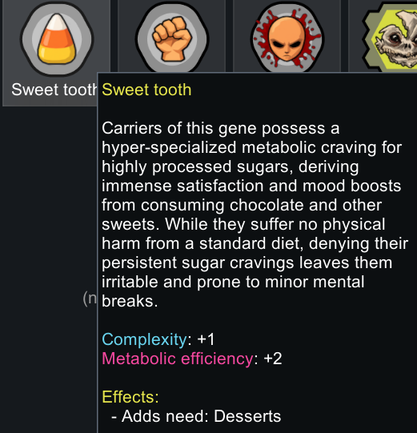
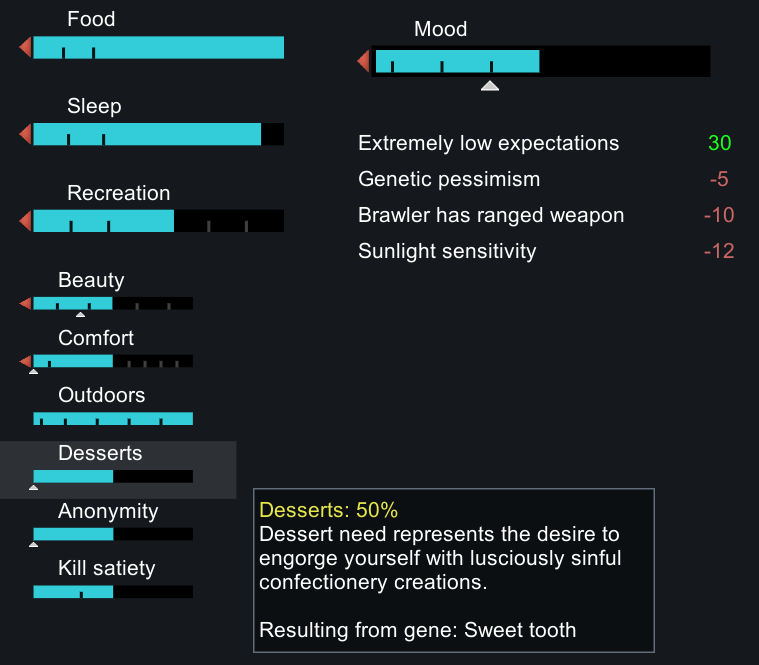
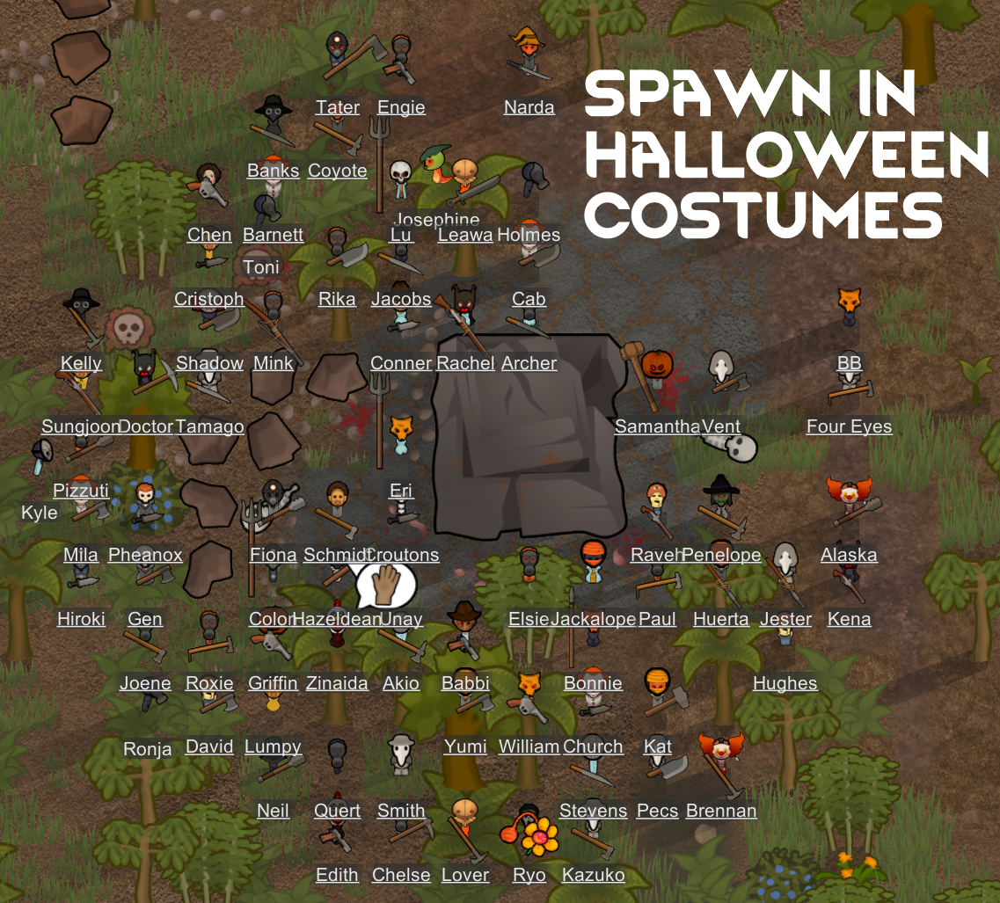
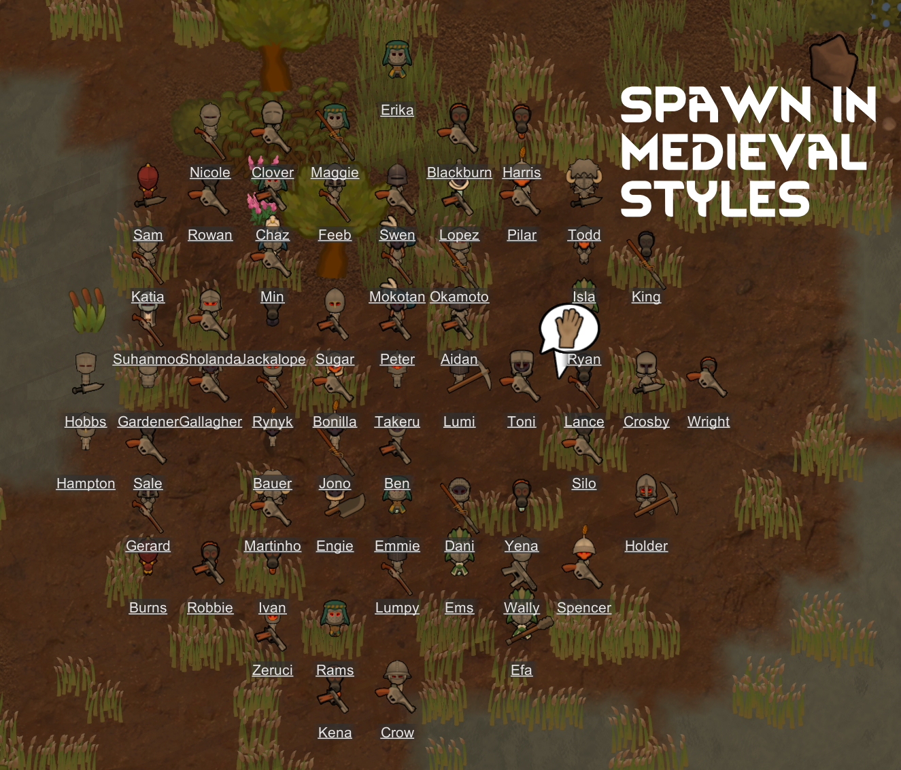
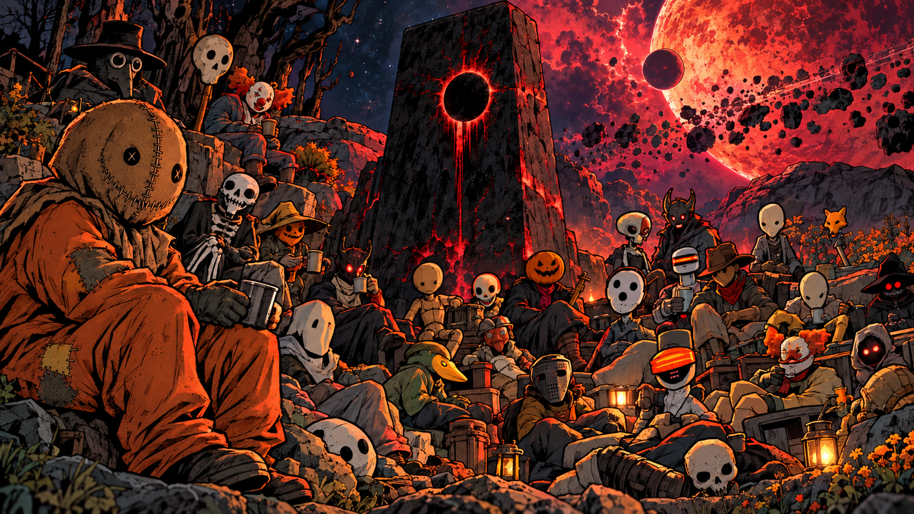

# Samhain Xenotype - Hidden Hungers

- EN: Adds Dessert need and Anonymity need to the [Samhain Xenotype](https://steamcommunity.com/sharedfiles/filedetails/?id=3829680933) to fully unlock their Halloween horror theme.
- ZH: 为“萨温”（Samhain）异种类型添加了“甜点需求”与“匿名需求”，从而完整呈现其万圣节恐怖主题。
- KO: '삼하인(Samhain)' 제노타입에 '디저트' 욕구와 '익명성' 욕구를 추가하여, 할로윈 공포 테마를 온전히 구현할 수 있도록 합니다.
- JA: サムハイン（Samhain）」ゼノタイプに「デザート」と「匿名性」の欲求を追加し、ハロウィーンのホラーというテーマを最大限に引き出します。
- RU: Добавляет ксенотипу «Самхейн» (Samhain) потребности в десертах и ​​анонимности, чтобы в полной мере раскрыть его тематику хеллоуинских ужасов.
- ES: Añade la necesidad de «Postre» y la necesidad de «Anonimato» al xenotipo Samhain, para así desplegar por completo su temática de terror de Halloween.
- FR: Ajoute le besoin de « dessert » et le besoin d’« anonymat » au xénotype Samhain, afin de concrétiser pleinement sa thématique d’horreur propre à Halloween.

## What You Get

- Samhain with Costumed gene will have anonymity need from Vanilla Memes and Structures Expanded no matter what their Ideology is.
- Samhain with Sweet Tooth gene will have dessert need from Vanilla Cooking Expanded no matter what their Ideology is.
- Costume Pool: Samhain joiners wear costumes from various mods if they are installed.

## Inspiration

Inspired by [Sam: The Soul of Halloween](https://samthesoulofhalloween.com/) created and owned by filmmaker Michael Dougherty. Sam was created in 1996 and can be seen in the 2007 movie "Trick R Treat" as well as several short films on YouTube and his website.

## Minimum Requirements

- Biotech DLC
- Ideology DLC
- [Samhain Xenotype](https://steamcommunity.com/sharedfiles/filedetails/?id=3829680933) (and it's dependencies)
- [Vanilla Memes and Structures Expanded](https://steamcommunity.com/sharedfiles/filedetails/?id=2636329500) (for Anonymity need with Costumed gene)

## Additional Content

These aren't required but they unlock additional content.

- [Vanilla Cooking Expanded](https://steamcommunity.com/sharedfiles/filedetails/?id=2134308519) - for Dessert need with Sweet Tooth gene.
- [Sam's Trick or Treat costume](https://steamcommunity.com/sharedfiles/filedetails/?id=3827335380) - Costume from the movie.

## Anonymity Need

The Costumed gene enables the Anonymity need to wear full head covering.

## Desserts Need

The Sweet Tooth gene enables the Desserts need to eat desserts from Vanilla Cooking Expanded.

## Costume Pool

Samhain will generate with a costume from the "Costume Pool" that can be configured from mod settings.

The mod settings can allow any FullHead apparel from any mod to be part of the costume pool.

To make it work better "out of the box" I added built-in support for a lot of Halloween and Medieval mods.

See [list of mods supported for the Costume Pool](https://github.com/oldmanwhistler/OMWSamhainXenotypeHH/blob/main/Docs/Costumes-Supported.md).

## Technical Details

- Safe to add to save. Safe to remove from save if you leave the base Samhain Xenotype mod in.
- VME and VCE are patched so that Anonymity and Dessert needs can be enabled by genes.
- There are 13 items who aren't FullHead apparel, but we patch them so they work with the anonymity need because they are COOL.
  - Lava’s Spooky Halloween: Cambion Mask, Harlequin Mask, Devil Mask, Skull Mask — originally Eyes.
  - Lisa’s Peasant Apparel: Executioner Hood, Plague Doctor Mask — originally UpperHead.
  - Pan-Halloweenie Integration II: Witches Hat, Mummy Head, Wolfman Mask, Devil Head — originally UpperHead.
  - Biomes! Fossils: Carnivore, Herbivore, and Mascot Dino Hats — originally UpperHead.

## Language Support

- English with machine translations for Simplified Chinese, Korean, Japanese, Russian, Spanish, and French.

## Links

- [Changelog](https://github.com/oldmanwhistler/OMWSamhainXenotypeHH/blob/main/Docs/CHANGELOG.md)
- Steam
- [GitHub](https://github.com/oldmanwhistler/OMWSamhainXenotypeHH)
- [AI Disclosure](https://github.com/oldmanwhistler/OMWSamhainXenotypeHH/blob/main/Docs/AI.md)
- [MIT License](https://github.com/oldmanwhistler/OMWSamhainXenotypeHH/blob/main/LICENSE)

## DISCLAIMER

This is an unofficial, non-commercial fan work, not affiliated with, endorsed by, or sponsored by Michael Dougherty or Sam: The Soul of Halloween. It does not include any assets or intellectual propery from Michael Dougherty, Trick 'R Treat, etc.

keywords: halloween, trick or treat, costumes, medieval overhaul
